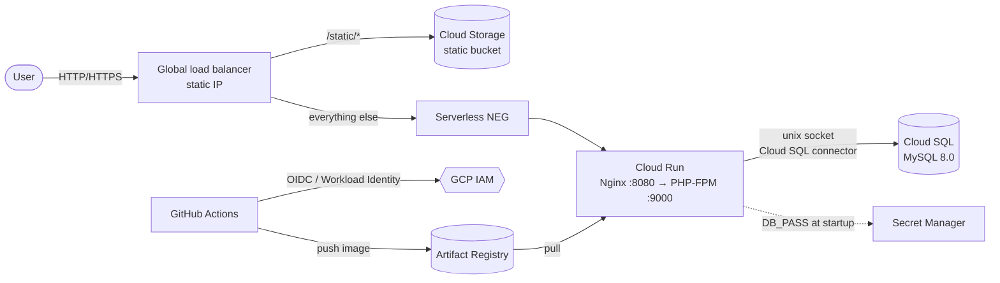

# PHP on Cloud Run: Terraform, GitHub Actions and Bash

A small PHP application (Nginx + PHP-FPM) running on **Google Cloud Run**, backed by **Cloud SQL (MySQL)**, with static files in **Cloud Storage**, published through a **global HTTP(S) load balancer**.

- **Infrastructure:** Terraform, split into reusable modules, with state stored remotely in GCS.
- **Delivery:** a tag-driven GitHub Actions pipeline that tests, scans (Trivy), builds, pushes and deploys, with automatic rollback.
- **Ops:** a Bash script that finds the app's public IP for any environment.

**Live (dev):** http://34.95.123.251

---

## Contents

1. [Architecture](#architecture)
2. [Repository layout](#repository-layout)
3. [Prerequisites](#prerequisites)
4. [Set up authentication and variables](#1-set-up-authentication-and-variables)
5. [Deploy the infrastructure](#2-deploy-the-infrastructure-terraform)
6. [Configure GitHub](#3-configure-github)
7. [Release the application](#4-release-the-application)
8. [Access the application](#5-access-the-application)
9. [Get the public IP (Bash script)](#6-get-the-public-ip-bash-script)
10. [Run locally](#7-run-locally)
11. [Security](#security)
12. [Troubleshooting](#troubleshooting)
13. [Problems I hit and how I solved them](#problems-i-hit-and-how-i-solved-them)
14. [Design decisions](#design-decisions)
15. [Production next steps](#production-next-steps)
16. [Cost and teardown](#cost-and-teardown)

---

## Architecture



**How a request flows**

1. The user hits the load balancer's **static IP**.
2. `/static/*` is served straight from the **Cloud Storage bucket**. Cloud Run is never touched.
3. Everything else goes to **Cloud Run**. Inside the container, **Nginx** passes PHP requests to **PHP-FPM**.
4. PHP connects to **Cloud SQL** through the built-in **Cloud SQL connector** (a unix socket, IAM-authenticated). The DB password comes from **Secret Manager**.

Cloud Run's own `*.run.app` URL is **closed to the internet** (ingress = load balancer only), so all traffic passes through the load balancer.

---

## Repository layout

```
app/                      PHP application
  public/index.php          routes: /  /healthz  /readyz
  public/static/            CSS + logo (synced to the static bucket on release)
  src/                      Config, Database, Health classes
  tests/Unit, Integration/  PHPUnit tests
docker/                   Container image
  Dockerfile                PHP-FPM + Nginx + supervisord, non-root, port 8080
  nginx/ php/ supervisor/   their configs
terraform/
  bootstrap/                run once: APIs, state bucket, GitHub OIDC (WIF), CI identities
  envs/dev/                 the dev environment (composes the modules)
  modules/                  iam, artifact-registry, cloudsql, storage, cloudrun, loadbalancer
.github/
  workflows/release.yml     tag-driven release pipeline
  workflows/security-rescan.yml  weekly Trivy rescan of running images
  dependabot.yml            weekly dependency update PRs
scripts/get-service-ip.sh Bash: public IP for an environment
trivy.yaml, .trivyignore  vulnerability policy and accepted risks
docker-compose.yml        run the same image + MySQL locally
dr.md, extra.md           disaster recovery plan, extra features
```

---

## Prerequisites

| Tool | Version used | Check |
|---|---|---|
| Google Cloud project with billing | `php-cloudrun-platform` | `gcloud projects describe <id>` |
| gcloud CLI | latest | `gcloud version` |
| Terraform | ≥ 1.5 (used 1.14) | `terraform version` |
| Git | any | `git --version` |
| Docker (local runs only) | any | `docker version` |

Your account needs **Owner** on the project for the first setup (bootstrap creates IAM resources).

---

## 1. Set up authentication and variables

### Authenticate

Terraform uses **Application Default Credentials (ADC)**, which is a *separate* login from the gcloud CLI. Run both:

```bash
gcloud auth login                                   # for gcloud commands
gcloud config set project php-cloudrun-platform
gcloud auth application-default login               # for Terraform
gcloud auth application-default set-quota-project php-cloudrun-platform
```

Check it worked:

```bash
gcloud auth list                                    # your account marked *
gcloud auth application-default print-access-token  # prints a token
```

> No service-account key files are used anywhere. Locally you use your own login; CI uses Workload Identity Federation.

### Terraform variables

Each Terraform folder has a `terraform.tfvars.example`. Copy it to `terraform.tfvars` (git-ignored) and adjust:

```bash
cp terraform/bootstrap/terraform.tfvars.example terraform/bootstrap/terraform.tfvars
cp terraform/envs/dev/terraform.tfvars.example   terraform/envs/dev/terraform.tfvars
```

The main variables:

| Variable | Where | Meaning | Example |
|---|---|---|---|
| `project_id` | both | GCP project | `php-cloudrun-platform` |
| `region` | both | Region for all regional resources | `europe-west1` |
| `github_repository` | bootstrap | Repo allowed to deploy via OIDC | `EddieByte/gcp-app-runner-cicd` |
| `enable_state_versioning` | bootstrap | Keep old state versions | `false` (test) / `true` (prod) |
| `environment` | dev | Environment name, used in resource names | `dev` |
| `db_tier` | dev | Cloud SQL machine size | `db-f1-micro` |
| `db_name`, `db_user` | dev | App database and user | `app` |
| `min_instances`, `max_instances` | dev | Cloud Run scaling | `0`, `3` |
| `enable_https` | dev | Managed certificate on `<ip>.nip.io` | `false` |
| `redirect_http_to_https` | dev | 301 HTTP → HTTPS (only once cert is ACTIVE) | `false` |

You can also pass any variable as an environment variable, e.g. `export TF_VAR_project_id=php-cloudrun-platform`.

The **DB password is never a variable.** Terraform generates it and stores it in Secret Manager.

---

## 2. Deploy the infrastructure (Terraform)

There are two Terraform "roots", applied in order:

| Root | Creates | State |
|---|---|---|
| `terraform/bootstrap` | APIs, state bucket, GitHub OIDC pool, CI service accounts | first local, then migrated into the bucket |
| `terraform/envs/dev` | Service accounts, Artifact Registry, Cloud SQL, secret, static bucket, Cloud Run, load balancer | `gs://php-cloudrun-platform-tfstate/env/dev` |

### Step 1: Bootstrap (once)

The state bucket can't hold the state of the code that creates it, so bootstrap starts with local state and then moves it into the bucket.

```bash
cd terraform/bootstrap
terraform init
terraform apply                 # ~12 APIs + bucket + WIF + CI identities
```

Then uncomment the `backend "gcs"` block in `backend.tf` and move the state:

```bash
terraform init -migrate-state   # answer "yes"
```

### Step 2: The dev environment

```bash
cd ../envs/dev
terraform init
terraform plan -out=tfplan      # review before applying
terraform apply tfplan          # Cloud SQL takes ~10-15 min
terraform output
```

Key outputs:

| Output | Use |
|---|---|
| `app_url` | Open in a browser |
| `lb_ip_address` | The app's public IP |
| `github_environment_vars` | Values for the GitHub `dev` environment |
| `db_connection_name` | Cloud SQL connection string used by Cloud Run |

> **First apply:** Cloud Run starts with Google's sample "hello" image. The first release tag replaces it with the real app. Terraform then ignores the image so it never undoes a release.

> **New load balancer:** allow **5-10 minutes** after the first apply before the IP serves traffic.

---

## 3. Configure GitHub

**Settings → Secrets and variables → Actions**

Get the values from Terraform:

```bash
terraform -chdir=terraform/bootstrap output github_vars
terraform -chdir=terraform/envs/dev  output github_environment_vars
```

**Repository variables** (not sensitive: they only work for tokens from this repo with the right tag):

| Name | Value |
|---|---|
| `GCP_PROJECT_ID` | `php-cloudrun-platform` |
| `GCP_REGION` | `europe-west1` |
| `GAR_REPOSITORY` | `php-app` |
| `IMAGE_NAME` | `php-app` |
| `WIF_PROVIDER` | from `github_vars` |
| `BUILDER_SA` | from `github_vars` |
| `SCANNER_SA` | from `github_vars` |
| `CLOUD_RUN_SERVICE_DEV` | `php-app-dev` |

**Repository secret:**

| Name | Purpose |
|---|---|
| `CI_DB_PASSWORD` | Password for the throwaway MySQL used by integration tests in CI. The real DB password never passes through GitHub. |

**Environment `dev`** (Settings → Environments → `dev`), with a deployment tag rule `dev-v*`:

| Name | Value |
|---|---|
| `DEPLOYER_SA` | from `github_environment_vars` |
| `CLOUD_RUN_SERVICE` | `php-app-dev` |
| `STATIC_BUCKET` | `php-cloudrun-platform-dev-static` |
| `APP_URL` | `http://34.95.123.251` (or the HTTPS URL) |

---

## 4. Release the application

**Nothing deploys on a normal push or merge.** Only release tags trigger the pipeline:

| Tag | Must be on branch | Deploys to |
|---|---|---|
| `dev-vX.Y.Z` | `dev` | dev |
| `vX.Y.Z` | `main` | prod (manual approval) |

```bash
git checkout dev
git tag dev-v1.0.5
git push origin dev-v1.0.5
```

### What the pipeline does (`.github/workflows/release.yml`)

```
guard ─► test ─► build ─► Trivy gate ─► push ─► deploy ─► smoke test
                                                   └─ fails? ─► automatic rollback
```

| Job | What happens |
|---|---|
| **guard** | Maps the tag to an environment and **refuses tags on the wrong branch**. |
| **test** | PHPUnit unit tests, then integration tests against a real MySQL 8.0 service container. |
| **build** | Builds the image, runs **Trivy**, publishes a report, and pushes to Artifact Registry **only if the scan passes** (no fixable HIGH/CRITICAL vulnerabilities, no secrets). |
| **deploy** | Syncs `/static` to the bucket, deploys the image **by digest** to Cloud Run (revision named after the tag), smoke-tests `/healthz`, `/readyz` and `/static/style.css` through the load balancer, and **rolls back** to the previous revision if anything fails. |

**Where to see the Trivy results:** the run's **Summary** page (severity table + full report), the run's **Artifacts** (JSON/table/SARIF), and **Security → Code scanning**.

**Authentication:** no keys. Each job exchanges GitHub's OIDC token for short-lived GCP credentials (Workload Identity Federation):

| Job | Identity | Can do |
|---|---|---|
| build | `ci-builder` | push images |
| deploy | `php-app-dev-deploy` | deploy dev only; a prod tag can't use it |
| weekly rescan | `ci-scanner` | read-only |

---

## 5. Access the application

| URL | Expected |
|---|---|
| http://34.95.123.251 | Status page: revision, PHP version, **Connected · MySQL 8.0**, visit counter |
| http://34.95.123.251/healthz | `{"status":"ok"}` (process is up; never touches the DB) |
| http://34.95.123.251/readyz | `{"status":"ok","db":"ok"}` (DB reachable) |
| http://34.95.123.251/static/style.css | CSS served from **Cloud Storage** |
| `https://php-app-dev-….run.app` | **Blocked** on purpose (load-balancer-only ingress) |

Type `http://` explicitly: browsers try HTTPS first, which only works once HTTPS is enabled.

**Enabling HTTPS** (no domain needed):

1. Set `enable_https = true` and apply. The certificate is issued for `34-95-123-251.nip.io`.
2. Wait until it's `ACTIVE` (15-60 min):
   ```bash
   gcloud compute ssl-certificates describe php-app-dev-cert --global --format="value(managed.status)"
   ```
3. Set `redirect_http_to_https = true` and apply.
4. Update `APP_URL` in the GitHub `dev` environment to the HTTPS URL.

---

## 6. Get the public IP (Bash script)

Cloud Run has **no fixed IP**; it gets a `*.run.app` URL. The app's public IP is the load balancer's **reserved static address**. The script finds it for any environment:

```bash
./scripts/get-service-ip.sh dev
```

```
2026-11-16T18:32:15Z [INFO] Run started: env=dev project=php-cloudrun-platform region=europe-west1
2026-11-16T18:32:15Z [INFO] Authenticated as you@example.com
2026-11-16T18:32:15Z [INFO] Service found: revision=php-app-dev-dev-v1-0-5 ingress=internal-and-cloud-load-balancing
2026-11-16T18:32:15Z [INFO] Health check OK: http://34.95.123.251/healthz returned 200

  Environment : dev
  Public IP   : 34.95.123.251
  App URL     : http://34.95.123.251

34.95.123.251
```

**Options**

| Option | Meaning |
|---|---|
| `dev` / `prod` | Environment (required). Sets the service name `php-app-<env>` and IP name `php-app-<env>-lb-ip`. |
| `-p, --project` | Project ID (default: `$GCP_PROJECT_ID` or `php-cloudrun-platform`) |
| `-r, --region` | Region (default: `$GCP_REGION` or `europe-west1`) |
| `--no-check` | Skip the HTTP health check |
| `-h, --help` | Show help |

**Use it in other commands:** only the IP is printed to stdout; messages go to stderr.

```bash
IP=$(./scripts/get-service-ip.sh dev)
curl "http://$IP/readyz"
```

**What it does, step by step**

1. Validates the environment and builds resource names from it.
2. Checks `gcloud` is installed and you're logged in.
3. Confirms the Cloud Run service exists (and shows its revision and ingress).
4. Reads the reserved IP of the environment's load balancer.
5. Optionally calls `/healthz` on that IP (a warning, not a failure, if it doesn't answer).
6. Prints the result and logs the run.

**Errors and exit codes**

| Code | Meaning | Fix |
|---|---|---|
| 1 | Missing or unknown environment / option | `./scripts/get-service-ip.sh dev` |
| 2 | `gcloud` not installed | Install the gcloud CLI |
| 3 | Not logged in | `gcloud auth login` |
| 4 | Cloud Run service not found | Deploy that environment first |
| 5 | Load balancer IP not found | Apply `terraform/envs/<env>` |

**Logging:** every run is appended to `logs/get-service-ip.log` (git-ignored) with UTC timestamps.

**On Windows:** run it in Git Bash or WSL.

---

## 7. Run locally

The same image as Cloud Run, plus MySQL:

```bash
docker compose up --build
# open http://localhost:8080
```

Locally the app connects over TCP (`DB_HOST=db`); on Cloud Run it uses the Cloud SQL socket. `app/src/Config.php` picks automatically.

**Tests:**

```bash
cd app
composer install
vendor/bin/phpunit --testsuite unit           # no database needed
DB_HOST=127.0.0.1 DB_NAME=app DB_USER=app DB_PASS=localpass \
  vendor/bin/phpunit --testsuite integration  # needs MySQL (e.g. docker compose up db)
```

**Scan the image yourself:**

```bash
docker build -f docker/Dockerfile -t php-app:local .
trivy image --config trivy.yaml php-app:local
```

---

## Security

| Area | What's in place |
|---|---|
| **Identity** | No service-account keys (blocked by org policy too). GitHub uses Workload Identity Federation; separate builder, per-environment deployer and read-only scanner identities. |
| **Least privilege** | Runtime SA: Cloud SQL client, logs/metrics, and read access to **one** secret. Deployer: Cloud Run + read on **one** image repository. |
| **Network** | Cloud Run accepts traffic only from the load balancer. Cloud SQL has no authorised networks; only the IAM-checked connector can reach it. |
| **Secrets** | DB password generated by Terraform, stored in Secret Manager, injected at runtime. Never in Git, images or GitHub. |
| **Container** | Non-root user, PHP-FPM on loopback, OS patches at build (`apk upgrade`), dangerous PHP functions disabled, `cgi.fix_pathinfo=0`. |
| **Supply chain** | Trivy gate before push; images pushed with **immutable tags** and deployed **by digest**; all actions pinned to commit SHAs; Dependabot; weekly rescan of running images. |
| **Release control** | Tag-only deploys, branch guard, environment tag rules, prod approval, branch/tag rulesets on GitHub. |

---

## Troubleshooting

| Symptom | Likely cause | Fix |
|---|---|---|
| `could not find default credentials` (Terraform) | ADC not set up | `gcloud auth application-default login` |
| `SERVICE_DISABLED` / quota project errors | API not enabled yet, or ADC charging another project | Wait a minute; `gcloud auth application-default set-quota-project <project>` |
| Browser shows nothing at the IP right after apply | Load balancer still propagating, or browser forced HTTPS | Wait 5-10 min; type `http://` explicitly |
| Status page says **Database: Unreachable** | Cloud Run can't reach Cloud SQL | Cloud Run → Logs, look for `[db]` lines; check the runtime SA has `cloudsql.client` |
| `/static/style.css` returns 404 | Bucket empty | Released yet? Or `gcloud storage rsync app/public/static gs://<bucket>/static --recursive` |
| Pipeline: `Tag ... is not on 'dev'` | Tag created on the wrong branch | Delete the tag, tag a commit on the right branch |
| Pipeline: Trivy gate fails | Fixable HIGH/CRITICAL vulnerability | Read the run Summary; rebuild (new tag) or record an accepted risk in `.trivyignore` with reason + expiry |
| Pipeline: `PERMISSION_DENIED` on auth | Wrong `WIF_PROVIDER`/SA variable, or tag doesn't match the identity's channel | Check the variables; dev tags can only use the dev deployer |
| Pipeline: deploy rolled back | Smoke test failed on the new revision | Cloud Run → Revisions → logs of the new revision |
| Managed certificate stuck in `PROVISIONING` | Normal for up to ~60 min | Keep HTTP serving; enable the redirect only once `ACTIVE` |
| Cloud SQL name already used after destroy | Names are reserved ~1 week | Handled: instance names get a random suffix |

---

## Problems I hit and how I solved them

| Problem | Cause | Fix |
|---|---|---|
| Project "not found" from the CLI | The console form was never submitted | Created the project with `gcloud projects create` under the organisation and linked billing |
| Org Policy API calls failed | ADC was charging quota to a different project | `set-quota-project` to this project |
| `terraform.exe` blocked by Windows Application Control | Chocolatey's `terraform.exe` is an **unsigned shim** | Ran the HashiCorp-**signed** binary directly via a PowerShell alias |
| Public IP showed nothing after apply | Global LB takes ~5 min; browser auto-upgraded to HTTPS | Waited; used `http://` explicitly; added optional HTTPS |
| `trivy-action@0.28.0` not found | Upstream renamed tags with a `v` prefix | Pinned `v0.36.0` **by commit SHA** (and later every action) |
| Deploy denied: `artifactregistry.repositories.downloadArtifacts` | After splitting builder/deployer identities, the deployer lost read access; `gcloud run deploy` checks it | Granted `artifactregistry.reader` on the one repository. **The automatic rollback restored the previous revision while this was broken.** |
| PHP couldn't see Cloud Run env vars (design-time catch) | PHP-FPM clears environment variables by default | `clear_env = no` in the FPM pool config |
| Node 20 / CodeQL v3 / `ubuntu-latest` warnings | Platform deprecations | Upgraded actions, pinned by SHA, pinned runner to `ubuntu-24.04` |

---

## Design decisions

| Decision | Why | Trade-off |
|---|---|---|
| Nginx + PHP-FPM in **one image** (supervisord) | Brief asks for a Dockerfile; simplest to run on Cloud Run and locally | Two processes per container; Cloud Run **sidecars** are the cleaner upgrade |
| **Load balancer IP** = "public IP of the service" | Cloud Run has no fixed IP | One more component; gains static IP, `/static` routing, TLS, Cloud Armor |
| **Artifact Registry**, not GCR | Container Registry is retired | Brief mentions GCR |
| Cloud SQL **public IP, no authorised networks** + connector | Secure (IAM-checked, encrypted) without VPC work | Private IP is stronger; listed under next steps |
| **Tag-driven releases** instead of "push to main" | Every deploy is deliberate and traceable | One extra command per release |
| Terraform owns the service, **CI owns the image** | They never overwrite each other (`ignore_changes`) | Image isn't visible in Terraform plans |
| Terraform applied **manually**, not in the pipeline | Pipeline stays app-only; infra changes are rare and reviewed | No automated infra delivery (HCP Terraform is the option) |
| State versioning **off** for the test | Minimal setup | No state rollback; one variable turns it on |

---

## Production next steps

- **Separate projects** for dev and prod; `terraform/envs/prod` with HA Cloud SQL (`REGIONAL`), `min_instances ≥ 1`, deletion protection on.
- **Private IP** for Cloud SQL with Direct VPC egress from Cloud Run.
- **Real domain** + managed certificate, HTTP→HTTPS redirect, HSTS.
- **Cloud Armor** WAF and rate limiting on the load balancer.
- **Monitoring:** uptime check on `/readyz`, alerts on 5xx rate, latency and Cloud SQL CPU/storage; dashboards.
- **IAM database authentication** instead of a password; lock down the MySQL `root` user.
- **State versioning on**, and **HCP Terraform** (or plan-on-PR) for reviewed infrastructure changes.
- **Cloud Build** as the image builder inside GCP; **Binary Authorization** to allow only signed, scanned images.
- **Cloud Run sidecars** for Nginx and PHP-FPM.

---

## Cost and teardown

Main costs while running: the **Cloud SQL** instance and the **load balancer forwarding rule(s)**. Cloud Run scales to zero.

To stop paying (keeps bootstrap, which costs ~nothing):

```bash
cd terraform/envs/dev
terraform plan -destroy -out=destroy.tfplan
terraform apply destroy.tfplan
```

Rebuild later with `terraform apply` (the load balancer IP will change, so update `APP_URL`).

---

More: [Disaster recovery plan](dr.md) · [Extra features](extra.md)
