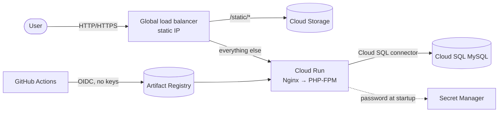

# PHP on Google Cloud Run: Terraform, GitHub Actions and Bash

A PHP application (Nginx + PHP-FPM) running on **Cloud Run** with a **Cloud SQL** database, static files on **Cloud Storage**, and a **global load balancer** in front. Everything is built with **Terraform** and released by a **GitHub Actions** pipeline that tests, scans and deploys it, with no stored credentials anywhere.


*The deployed app: every row is a working part of the stack. The revision is named after the release tag, the database connection goes through the Cloud SQL connector, the visit counter is stored in Cloud SQL, and the styling comes from Cloud Storage.*

---

## What this project delivers

- **Infrastructure entirely in code.** 6 reusable Terraform modules build the whole environment in one `apply`: Cloud SQL, Cloud Run, load balancer, static bucket, registry and IAM. State is stored remotely in GCS.
- **No passwords or keys anywhere.** GitHub authenticates to Google Cloud with short-lived OIDC tokens (Workload Identity Federation). The database password is generated by Terraform, kept in Secret Manager, and never touches Git, GitHub or the image.
- **Controlled releases.** Nothing deploys on a push. A `dev-vX.Y.Z` tag on `dev` deploys to dev; a `vX.Y.Z` tag on `main` deploys to prod after approval. A tag on the wrong branch is refused.
- **Nothing vulnerable ships.** Every image is scanned with Trivy *before* it is pushed; fixable HIGH/CRITICAL issues stop the release. Each run publishes a scan report, and a weekly job rescans the images already running.
- **Safe deployments.** Images are deployed by digest, smoke-tested through the load balancer, and **rolled back automatically** if a check fails. (This happened for real during the build; see [Problems solved](#problems-solved).)
- **Locked-down network.** Cloud Run only accepts traffic from the load balancer, and Cloud SQL accepts no network connections at all, only the IAM-authenticated connector.
- **Tested.** Unit tests plus integration tests against a real MySQL 8.0 on every release.

---

## Architecture



1. Users reach the load balancer's **static IP**.
2. `/static/*` is served straight from **Cloud Storage**; everything else goes to **Cloud Run**.
3. Inside the container, **Nginx** passes PHP requests to **PHP-FPM**.
4. PHP connects to **Cloud SQL** over the Cloud SQL connector's unix socket.

---

## Release pipeline

```
tag pushed ─► guard ─► test ─► build ─► Trivy gate ─► push ─► deploy ─► smoke test
                                                                  └─ fails? ─► rollback
```

| Stage | What it does |
|---|---|
| **guard** | Picks the environment from the tag and checks the tag is on the right branch |
| **test** | PHPUnit unit tests, then integration tests against MySQL |
| **build** | Builds the image, scans it with Trivy, publishes the report, pushes only if clean |
| **deploy** | Uploads static files, deploys the exact scanned image, checks `/healthz`, `/readyz` and `/static` through the load balancer, rolls back on failure |

Release with:

```bash
git checkout dev && git tag dev-v1.0.0 && git push origin dev-v1.0.0
```

Details: [docs/design.md](docs/design.md#release-pipeline)

---

## Quick start

Full instructions, every variable and the GitHub settings are in **[docs/setup.md](docs/setup.md)**.

```bash
# 1. Log in (Terraform uses Application Default Credentials)
gcloud auth login
gcloud auth application-default login

# 2. One-time foundation: APIs, state bucket, GitHub OIDC, CI identities
cd terraform/bootstrap
cp terraform.tfvars.example terraform.tfvars
terraform init && terraform apply
#    then uncomment backend.tf and run: terraform init -migrate-state

# 3. The dev environment (Cloud SQL takes ~10-15 min)
cd ../envs/dev
cp terraform.tfvars.example terraform.tfvars
terraform init && terraform apply
terraform output app_url

# 4. Add the GitHub variables printed by:
terraform output github_environment_vars
terraform -chdir=../../bootstrap output github_vars

# 5. Release
git tag dev-v1.0.0 && git push origin dev-v1.0.0
```

Then open the app at `http://<load-balancer-ip>` (allow ~5-10 min for a new load balancer).

---

## Get the public IP

Cloud Run has **no fixed IP**; it only has a `*.run.app` URL. The app's public IP is the load balancer's reserved address, and this script finds it for any environment:

```bash
./scripts/get-service-ip.sh dev          # prints the IP
IP=$(./scripts/get-service-ip.sh dev)    # or capture it
```

- **Takes an environment** (`dev` / `prod`) and derives the resource names from it. Options: `--project`, `--region`, `--no-check`, `--help`.
- **Checks before it answers:** `gcloud` installed, logged in, service deployed, IP reserved. It then health-checks `/healthz` on the IP.
- **Clear errors with exit codes:** `1` usage, `2` no gcloud, `3` not logged in, `4` service not found, `5` IP not found.
- **Logs every run** to `logs/get-service-ip.log`.

---

## Repository layout

```
app/          PHP app (status page, /healthz, /readyz) and PHPUnit tests
docker/       Dockerfile + Nginx, PHP-FPM and supervisord config
terraform/    bootstrap/ (one-time), envs/dev/, modules/ (6 reusable modules)
.github/      release pipeline and weekly security rescan
scripts/      get-service-ip.sh
docs/         setup guide, design and security notes, images
dr.md         disaster recovery plan
extra.md      extra features
```

---

## Problems solved

| Problem | Fix |
|---|---|
| Windows blocked `terraform.exe` | It was Chocolatey's **unsigned shim**; ran the HashiCorp-signed binary instead |
| Deploy denied reading the image | Splitting push and deploy identities removed the deployer's read access. Granted read on the one repository. **The automatic rollback kept the app up meanwhile.** |
| `trivy-action@0.28.0` not found | Upstream renamed its tags; pinned every action **by commit SHA** instead |
| App invisible right after deploy | A new global load balancer needs ~5 min, and browsers force HTTPS; added optional HTTPS |

Full list: [docs/design.md](docs/design.md#problems-i-hit-and-how-i-solved-them) · Troubleshooting: [docs/setup.md](docs/setup.md#troubleshooting)

---

## Production next steps

- Separate prod project with high-availability Cloud SQL, minimum instances ≥ 1, deletion protection
- Private IP for Cloud SQL; real domain with HTTPS and HSTS
- Cloud Armor (WAF, rate limiting) on the load balancer
- Monitoring: uptime check on `/readyz`, alerts on errors, latency and database load
- Cloud Build for image builds; HCP Terraform for reviewed infrastructure changes

---

## Cost

The running costs are Cloud SQL and the load balancer; Cloud Run scales to zero. `terraform destroy` in `envs/dev` brings the cost to about zero while keeping the foundation for a one-command rebuild.

---

**Docs:** [Setup and operations](docs/setup.md) · [Design and security](docs/design.md) · [Disaster recovery](dr.md) · [Extras](extra.md)
