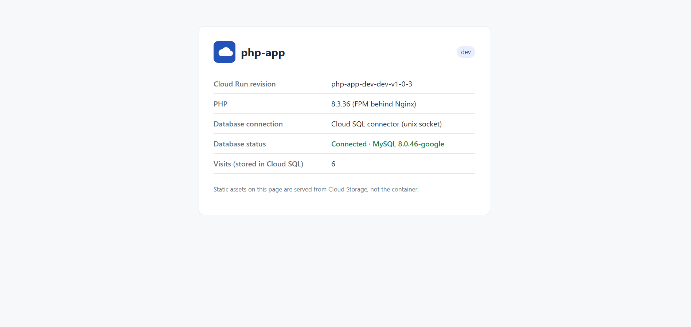
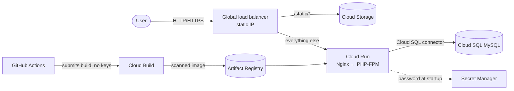
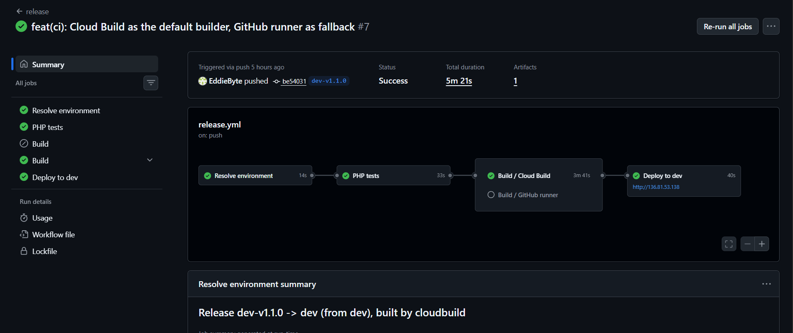
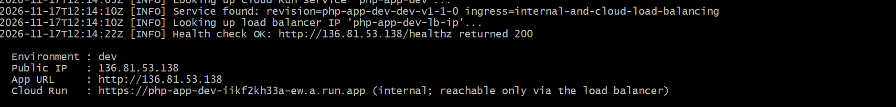
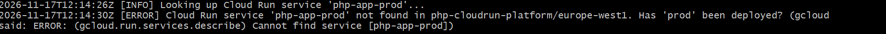

# PHP on Google Cloud Run: Terraform, GitHub Actions and Bash

A PHP application (Nginx + PHP-FPM) running on **Cloud Run**, with a **Cloud SQL (MySQL)** database, static files on **Cloud Storage** and a **global load balancer** in front.

The whole platform is built with **Terraform**, released by a **GitHub Actions** pipeline that tests, scans and deploys it (images built in **Cloud Build**), and operated with a **Bash** script that finds the app's public IP. No passwords or keys are stored anywhere.



*The live app. Every row is a working part of the stack: the revision is named after the release tag, the database is reached through the Cloud SQL connector, the visit counter is stored in Cloud SQL, and the styling is served from Cloud Storage.*

---

## Contents

- [What this project accomplishes](#what-this-project-accomplishes) · [Architecture](#architecture)
- **How to use it:** [1. Set up Terraform environment variables](#1-set-up-terraform-environment-variables) · [2. Deploy the infrastructure](#2-deploy-the-infrastructure-with-terraform) · [3. Release the application](#3-release-the-application) · [4. Access the application](#4-access-the-deployed-application) · [5. Get the public IP](#5-get-the-public-ip-with-the-bash-script)
- **Running it:** [Troubleshooting](#troubleshooting) · [Problems encountered and how I solved them](#problems-encountered-and-how-i-solved-them) · [Production-ready next steps](#production-ready-next-steps) · [Use of AI](#use-of-ai)

---

## What this project accomplishes

| Area | What was achieved |
|---|---|
| **Infrastructure as code** | 6 reusable Terraform modules create the whole environment in one `apply`. State is stored remotely in GCS with locking. |
| **Automated, controlled releases** | Pushing a release tag runs tests, builds and scans the image, deploys it and checks it. Ordinary pushes deploy nothing. |
| **Nothing vulnerable ships** | Trivy scans every image *before* it is pushed; fixable HIGH/CRITICAL issues stop the release. |
| **Safe deployments** | A failed health check after deploy **rolls back automatically**. This happened for real during the build and kept the app up. |
| **No stored credentials** | GitHub signs in to Google Cloud with short-lived tokens. The DB password is generated by Terraform and kept in Secret Manager. |
| **Locked-down network** | Only the load balancer can reach Cloud Run; nothing can reach Cloud SQL over the network. |

---

## Architecture



**How a request flows**

1. The user reaches the load balancer's **static IP**.
2. `/static/*` is served straight from **Cloud Storage**; everything else goes to **Cloud Run**.
3. Inside the container, **Nginx** passes PHP requests to **PHP-FPM**.
4. PHP talks to **Cloud SQL** through the Cloud SQL connector (IAM-authenticated, encrypted).

**How a release flows**

```
tag ─► check tag ─► PHP tests ─► Cloud Build: build ─► Trivy ─► push ─► deploy ─► smoke test
                                                                                └─ fails? ─► rollback
```



*A real release (`dev-v1.1.0`): exactly one builder ran (Cloud Build); the GitHub-runner fallback was skipped. The deploy job links to the live app.*

---

## 1. Set up Terraform environment variables

**Prerequisites:** a Google Cloud project with billing, the `gcloud` CLI, Terraform ≥ 1.5 and Git. Your account needs **Owner** on the project for the first setup.

**Log in.** Terraform uses Application Default Credentials, a separate login from the `gcloud` CLI, so run both:

```bash
gcloud auth login
gcloud config set project php-cloudrun-platform
gcloud auth application-default login
gcloud auth application-default set-quota-project php-cloudrun-platform
```

**Set the variables.** Each Terraform folder has an example file. Copy it and adjust:

```bash
cp terraform/bootstrap/terraform.tfvars.example terraform/bootstrap/terraform.tfvars
cp terraform/envs/dev/terraform.tfvars.example   terraform/envs/dev/terraform.tfvars
```

| Variable | Meaning | Example |
|---|---|---|
| `project_id` | Google Cloud project | `php-cloudrun-platform` |
| `region` | Region for all resources | `europe-west1` |
| `environment` | Environment name, used in resource names | `dev` |
| `github_repository` | Repo allowed to deploy (bootstrap) | `EddieByte/gcp-app-runner-cicd` |
| `db_tier` | Cloud SQL machine size | `db-f1-micro` |
| `min_instances` / `max_instances` | Cloud Run scaling | `0` / `3` |
| `enable_https` | Managed HTTPS certificate on `<ip>.nip.io` | `false` |

Any variable can also be set as an environment variable instead, e.g. `export TF_VAR_project_id=php-cloudrun-platform`.

`terraform.tfvars` files are git-ignored. **There is no password variable:** Terraform generates the database password and stores it in Secret Manager.

All variables: [docs/setup.md](docs/setup.md#set-up-authentication-and-variables)

---

## 2. Deploy the infrastructure with Terraform

The code is split into two parts, applied in order:

| Folder | Creates | Run |
|---|---|---|
| `terraform/bootstrap` | APIs, Terraform state bucket, GitHub sign-in (OIDC), CI service accounts, Cloud Build setup | once |
| `terraform/envs/dev` | Cloud SQL, Cloud Run, load balancer, static bucket, image registry, app service accounts | per environment |

**Step 1: the foundation (once)**

```bash
cd terraform/bootstrap
terraform init
terraform apply
```

This creates the state bucket, so its own state starts locally. Move it into the bucket: uncomment the block in `backend.tf`, then run `terraform init -migrate-state`.

**Step 2: the environment**

```bash
cd ../envs/dev
terraform init
terraform plan -out=tfplan      # review what will be created
terraform apply tfplan          # Cloud SQL takes ~10-15 minutes
terraform output
```

The outputs include the app URL, the load balancer IP and the values to copy into GitHub.

> The first apply starts Cloud Run with a placeholder image. The first release replaces it with the real app.

---

## 3. Release the application

**One-time GitHub setup:** copy the values from `terraform output github_vars` (bootstrap) and `terraform output github_environment_vars` (dev) into the repo's **Settings → Secrets and variables → Actions**, plus a `dev` environment. The full list is in [docs/setup.md](docs/setup.md#configure-github).

**Release by pushing a tag.** Nothing deploys on a normal push:

```bash
git checkout dev
git tag dev-v1.0.0
git push origin dev-v1.0.0
```

| Tag | Must be on | Deploys to |
|---|---|---|
| `dev-vX.Y.Z` | `dev` branch | dev |
| `vX.Y.Z` | `main` branch | prod (after approval) |

Watch it under **Actions → release**. Each run shows a Trivy scan summary, and the build can also be followed in **Cloud Build → History**.

---

## 4. Access the deployed application

Open the load balancer's IP in a browser (`terraform output app_url`, or the script below). A new load balancer needs **5-10 minutes** before it serves traffic.

| URL | What you get |
|---|---|
| `http://<lb-ip>/` | Status page: revision, PHP version, database status, visit counter |
| `http://<lb-ip>/healthz` | `{"status":"ok"}` (the app is running) |
| `http://<lb-ip>/readyz` | `{"status":"ok","db":"ok"}` (the database is reachable) |
| `http://<lb-ip>/static/style.css` | CSS served from Cloud Storage |
| `https://…run.app` | **Blocked on purpose**: Cloud Run only accepts traffic from the load balancer |

Type `http://` explicitly: browsers try HTTPS first. To add HTTPS without a domain, set `enable_https = true` (see [docs/setup.md](docs/setup.md#access-the-application)).

---

## 5. Get the public IP with the Bash script

Cloud Run has **no fixed IP address**, only a `*.run.app` URL. The app's public IP is the load balancer's reserved address, and `scripts/get-service-ip.sh` finds it for any environment:

```bash
./scripts/get-service-ip.sh dev          # Bash: Linux, macOS, WSL, Git Bash, Cloud Shell
IP=$(./scripts/get-service-ip.sh dev)    # capture only the IP
```

```bat
scripts\get-service-ip.cmd dev           :: Windows cmd or PowerShell (runs the same script via Git Bash)
```



| Feature | Detail |
|---|---|
| **Environment argument** | `dev` or `prod`; the service and IP names are derived from it. Options: `--project`, `--region`, `--no-check`, `--help` |
| **Checks before answering** | gcloud installed, logged in, service deployed, IP reserved; then a health check on `/healthz` |
| **Error handling** | A clear message and exit code for each problem: `1` usage, `2` no gcloud, `3` not logged in, `4` service not found, `5` IP not found |
| **Logging** | Every run is appended to `logs/get-service-ip.log` with timestamps |



---

## Troubleshooting

| Symptom | Likely cause | Fix |
|---|---|---|
| Terraform: `could not find default credentials` | Terraform login missing | `gcloud auth application-default login` |
| Terraform: `SERVICE_DISABLED` or quota project error | API still enabling, or credentials billed to another project | Wait a minute; `gcloud auth application-default set-quota-project <project>` |
| Terraform: `Error acquiring the state lock` | A previous run was interrupted | `terraform force-unlock <LOCK_ID>` (only if no one else is running Terraform) |
| Nothing at the IP right after deploy | Load balancer still starting, or browser forced HTTPS | Wait 5-10 min; type `http://` |
| Status page: **Database unreachable** | Cloud Run can't reach Cloud SQL | Cloud Run → Logs, look for `[db]`; check the runtime account has `cloudsql.client` |
| `/static/style.css` returns 404 | Bucket not yet filled | Push a release (it uploads the files) |
| Pipeline: `not on 'dev'` | Tag created on the wrong branch | Delete the tag and tag a commit on the right branch |
| Pipeline: Trivy stops the release | Fixable HIGH/CRITICAL vulnerability | Read the run Summary; rebuild with a new tag once fixed |
| Pipeline: deploy rolled back | New version failed its health check | Cloud Run → Revisions → logs of the new revision |
| Script in PowerShell does nothing | Windows opened the `.sh` file with another program | Use `scripts\get-service-ip.cmd dev` |

More: [docs/setup.md](docs/setup.md#troubleshooting)

---

## Problems encountered and how I solved them

| Problem | What was going on | How I solved it |
|---|---|---|
| `terraform.exe` blocked by Windows | Windows Application Control blocked Chocolatey's **unsigned** launcher for Terraform | Ran the HashiCorp-**signed** Terraform binary directly through a PowerShell alias |
| Org Policy commands failed | Credentials were billing API usage to a different project | Set the quota project to this project |
| Nothing showed at the IP after the first deploy | A new global load balancer takes ~5 minutes; the browser also forced HTTPS | Waited and used `http://`; added optional HTTPS for later |
| `trivy-action@0.28.0` not found | The action's maintainers renamed their version tags | Pinned it, and then every action, **by commit SHA**, which also protects against tampered tags |
| Deploy refused to read the image | Separating the "push" and "deploy" identities removed the deployer's read access | Gave the deployer read access to the one image repository. **The automatic rollback kept the previous version serving meanwhile** |
| Dependabot opened PRs that made no sense | It was comparing against an out-of-date `main` branch | Brought `main` up to date and removed Dependabot; upgrades are done deliberately |
| Internet dropped during `terraform apply` | Terraform couldn't save its state or release its lock; GCP kept creating the database | Released the lock, uploaded the saved state, and imported the database. Nothing was lost or duplicated |
| Script in PowerShell ignored its arguments | Windows opened the `.sh` file with its default program | Added `get-service-ip.cmd`, which runs the same script through Git Bash |

Full details: [docs/design.md](docs/design.md#problems-i-hit-and-how-i-solved-them)

---

## Production-ready next steps

**Monitoring and observability**
- Uptime check on `/readyz` with alerts (email or chat) when it fails
- Alerts on error rate, response time and Cloud SQL CPU/disk; a dashboard for all of it
- Structured (JSON) logs so they can be filtered by severity and field

**Security**
- Cloud Armor in front of the load balancer (web attack rules, rate limiting)
- Binary Authorization: only run images built and scanned by our Cloud Build
- Private IP for Cloud SQL; IAM database login instead of a password
- A real domain with HTTPS only and HSTS

**Reliability**
- A separate production project with high-availability Cloud SQL and a minimum of one running instance
- Cross-region backups and a read replica (see the [disaster recovery plan](dr.md))
- Terraform state versioning turned on

**Delivery**
- Reviewed infrastructure changes (Terraform plan on pull requests, e.g. with HCP Terraform)

---

## Use of AI

This project was built with the help of an AI assistant (Claude, by Anthropic).

- **AI assisted with:** drafting the Terraform modules, GitHub Actions workflows, Dockerfile, PHP application, Bash script and documentation; explaining Google Cloud concepts (I come from AWS); and suggesting fixes for errors.
- **I was responsible for:** the design decisions (tag-only releases, Cloud Build as the builder with a fallback, keeping infrastructure changes out of the pipeline, removing Dependabot), setting up and operating the Google Cloud and GitHub environments, running and verifying every deployment, debugging real issues (Windows Application Control, a network drop mid-apply and the state recovery, IAM permission errors), and reviewing and revising all code and docs.

I can walk through and explain any part of the code and the reasoning behind it.

---

## Repository layout

```
app/             PHP app (status page, /healthz, /readyz) and PHPUnit tests
docker/          Dockerfile + Nginx, PHP-FPM and supervisord config
terraform/       bootstrap/ (once), envs/dev/, modules/ (6 reusable modules)
.github/         release pipeline, Cloud Build / GitHub build workflows, weekly security rescan
cloudbuild.yaml  Cloud Build steps: build → Trivy → push
scripts/         get-service-ip.sh (+ .cmd wrapper for Windows)
docs/            setup guide, design and security notes, screenshots
dr.md            disaster recovery plan
extra.md         extra features and the reasoning behind them
```

**Cost and teardown:** the running costs are Cloud SQL and the load balancer; Cloud Run scales to zero. To stop paying, remove the environment and keep the foundation for a one-command rebuild:

```bash
cd terraform/envs/dev
terraform plan -destroy -out=destroy.tfplan
terraform apply destroy.tfplan
```

How to check it worked, and how to remove everything: [docs/setup.md](docs/setup.md#cost-and-teardown).

**More docs:** [Setup and operations](docs/setup.md) · [Design and security](docs/design.md) · [Disaster recovery](dr.md) · [Extras](extra.md)
