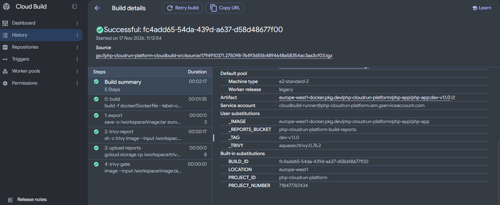

# Extras: going further

The core of this project is Terraform, a CI/CD pipeline and a Bash script. Along the way, several decisions were taken to make it closer to how a production system should be built and run. This page explains each one: what was done, and why it is worth having in a real project.

| # | Extra | In one line |
|---|---|---|
| 1 | [Cloud Build as the trusted builder](#1-cloud-build-as-the-trusted-builder) | Images are built, scanned and pushed inside GCP; GitHub holds no push rights |
| 2 | [Keyless CI with one identity per job](#2-keyless-ci-with-one-identity-per-job) | No service-account keys exist; a dev release can never obtain prod rights |
| 3 | [Five layers of release control](#3-five-layers-of-release-control) | Only the right tag, on the right branch, by the right person, deploys |
| 4 | [Supply-chain security](#4-supply-chain-security) | Nothing vulnerable ships; every dependency is pinned |
| 5 | [Self-healing deployments](#5-self-healing-deployments) | Failed releases roll back automatically (proven in practice) |
| 6 | [Locked-down network and container](#6-locked-down-network-and-container) | One public entry point; the database accepts no network connections |
| 7 | [Working within secure-by-default org policies](#7-working-within-secure-by-default-org-policies) | Built to fit the organisation's guardrails, not around them |
| 8 | [HTTPS without a domain](#8-https-without-a-domain) | Managed certificate on `<ip>.nip.io`, with a safe redirect switch |
| 9 | [Coming from AWS](#9-coming-from-aws) | How the AWS concepts mapped to GCP |
| 10 | [Cost awareness](#10-cost-awareness) | Scale to zero, cleanup policies, one-command teardown |

---

## 1. Cloud Build as the trusted builder

GitHub Actions runs the release (tags, tests, approvals, deploy, rollback), but the **image is built in Cloud Build**:

```
GitHub: guard → test → submit build ─┐                    ┌─► deploy → smoke test → rollback
                                     ▼                    │
                   Cloud Build: build → Trivy report → Trivy gate → push   (as cloudbuild-runner)
```



**Why it matters**

- **GitHub can't push images.** On this path `ci-builder` can only *submit* builds. Only `cloudbuild-runner`, inside GCP, can write to Artifact Registry. A leaked GitHub token can't publish an image.
- **The image never leaves Google's network** before it is scanned and pushed.
- **Nothing is pushed unless every step passes**, because Cloud Build pushes the `images:` list only at the end.
- The Cloud Build log and the Trivy report flow back into the GitHub run, so there's still one place to look.

**Designed as a choice, not a duplicate.** `release.yml` is the only workflow triggered by tags; the build is delegated to one of two reusable workflows: `build-cloudbuild.yml` (default) or `build-github.yml` (break-glass fallback, selectable per run). Guard, tests, deploy and rollback exist once.

---

## 2. Keyless CI with one identity per job

GitHub authenticates with **Workload Identity Federation**: each job swaps GitHub's short-lived OIDC token for short-lived GCP credentials. There are **no service-account keys** (the org policy forbids them anyway).

Each job gets its own identity with only what it needs:

| Identity | Used by | Can do |
|---|---|---|
| `ci-builder` | build job | submit Cloud Builds (and push, for the fallback path) |
| `cloudbuild-runner` | Cloud Build | push images, write logs and reports |
| `php-app-dev-deploy` | deploy job | deploy Cloud Run in **dev only**; read one image repository |
| `ci-scanner` | weekly rescan | read-only |
| `php-app-dev-run` | the running app | connect to Cloud SQL, read **one** secret, write logs |

**The release-channel trick.** The identity provider computes a `channel` attribute from the token: `dev` for `dev-v*` tags, `prod` for `v*` tags, `scan` for scheduled runs. Each deployer trusts exactly one channel, so **a dev tag cannot obtain prod deploy rights**, even if someone edits the workflow. Tokens from any other repository are rejected before IAM is even checked.

---

## 3. Five layers of release control

Nothing deploys on a push or merge. Releases are tags, and five independent checks must all agree:

| Layer | Enforces |
|---|---|
| GitHub tag ruleset | Only the admin can create release tags; tags can't be moved or deleted |
| Workflow `guard` job | `dev-v*` must be on `dev`, `v*` must be on `main`; manual runs must start from a release tag |
| GitHub environments | `dev` accepts only `dev-v*`; `prod` requires approval |
| Workload Identity channel | The GCP deployer for an environment only accepts that environment's tags |
| Artifact Registry | Image tags are immutable: `dev-v1.1.0` always means the image that was scanned |

---

## 4. Supply-chain security

| Control | Detail |
|---|---|
| **Trivy gate before push** | Fixable HIGH/CRITICAL vulnerabilities or leaked secrets stop the release. Unfixable ones are reported, not blocking. Policy in `trivy.yaml`, accepted risks in `.trivyignore` (each with reason, owner, expiry) |
| **Visible reports** | Every run shows a severity table and the full report on its Summary page, plus JSON/table artifacts |
| **Weekly rescan** | A scheduled job rescans the images **actually running**, because a clean image can become vulnerable when a new CVE is published |
| **Deploy by digest** | Cloud Run runs exactly the scanned bytes, not "whatever the tag points to" |
| **Everything pinned** | Every GitHub Action is pinned to a full commit SHA (a tag can be moved to malicious code; a SHA can't). The runner OS (`ubuntu-24.04`), Trivy (`0.76.2`), PHP (`8.3`) and Terraform providers are pinned too. Upgrades are deliberate commits |
| **OS patches every build** | `apk upgrade` in the Dockerfile picks up Alpine security fixes released after the base image |

This builds on a previous project ([cicd-eks-pipeline](https://github.com/EddieByte/cicd-eks-pipeline)), where Trivy was report-only and "make it a blocking gate" was listed as the next step. Here it is blocking.

---

## 5. Self-healing deployments

After deploying, the pipeline smoke-tests `/healthz`, `/readyz` and `/static/style.css` **through the load balancer**, exactly as users reach the app. If any check fails, traffic goes back to the previous revision automatically.

**Proven in practice.** During the build, a deploy was denied because of a missing permission. The rollback step ran and kept the previous revision serving while the permission was fixed. The app never went down.

The app also separates its health checks:

- `/healthz` (liveness) never touches the database, so a database outage doesn't make Cloud Run restart healthy containers.
- `/readyz` (readiness) checks the database and returns `503` when it's unreachable.

---

## 6. Locked-down network and container

**Network**

- Cloud Run accepts traffic **only from the load balancer**; its `*.run.app` URL is closed to the internet.
- Cloud SQL has a public IP but **no authorised networks**: nothing can connect over the network. The app connects only through the IAM-authenticated, encrypted Cloud SQL connector.
- Static files are served from Cloud Storage at the load balancer and never reach the container.

**Container**

- Runs as the unprivileged `www-data` user.
- PHP-FPM listens only on `127.0.0.1` inside the container.
- `exec`, `system`, `shell_exec`, `proc_open` and similar are disabled, and `allow_url_fopen` is off. Injected code couldn't run commands or download payloads.
- `cgi.fix_pathinfo=0` and Nginx's `try_files $uri =404` close the classic PHP-FPM + Nginx path-info flaw (CVE-2019-11043).
- If Nginx or PHP-FPM dies, the container exits and Cloud Run replaces it, instead of serving half a stack.

---

## 7. Working within secure-by-default org policies

The organisation enforces Google's secure-by-default policies. Instead of turning them off, the design fits them:

| Policy | Effect | How the project works with it |
|---|---|---|
| No service-account key creation/upload | Keys impossible | Workload Identity Federation everywhere |
| No automatic roles for default service accounts | Default Compute and Cloud Build accounts have no permissions | Dedicated, least-privilege service accounts for Cloud Run, Cloud Build and CI |
| Uniform bucket-level access required | No per-object ACLs | Every bucket uses IAM only |

---

## 8. HTTPS without a domain

Google-managed certificates need a domain. The load balancer module builds one from the reserved IP using [nip.io](https://nip.io) (`136-81-53-138.nip.io` resolves to `136.81.53.138`), so HTTPS works without buying a domain.

The **HTTP→HTTPS redirect is a separate switch** (`redirect_http_to_https`), turned on only after the certificate is `ACTIVE`. Turning both on at once would make the site unreachable for the 15-60 minutes a certificate takes to provision.

---

## 9. Coming from AWS

This was a first GCP build after working mainly on AWS. The mapping used:

| AWS | GCP (used here) |
|---|---|
| Account | Project |
| Organizations / SCPs | Organization / org policies |
| IAM role assumed by a workload | Service account |
| GitHub OIDC provider + role trust policy | Workload Identity pool + provider + attribute condition |
| ECR | Artifact Registry |
| ECS Fargate / App Runner | Cloud Run |
| ALB + target group | Global load balancer + serverless NEG |
| RDS MySQL | Cloud SQL for MySQL |
| S3 | Cloud Storage |
| SSM Parameter Store / Secrets Manager | Secret Manager |
| CodeBuild | Cloud Build |
| S3 + DynamoDB state locking | GCS backend (locking built in) |

**What surprised me**

- **APIs must be enabled** per project before anything can be created (handled in `terraform/bootstrap`).
- **Two separate logins:** `gcloud auth login` for the CLI, `gcloud auth application-default login` for Terraform.
- **IAM is attached to resources** ("this member has this role on this bucket") rather than policies attached to identities.
- **Cloud Run has no fixed IP**, which is why the "public IP of the service" is the load balancer's reserved address.

---

## 10. Cost awareness

- Cloud Run scales to zero and only bills CPU while handling requests.
- Smallest Cloud SQL tier for dev (`db-f1-micro`, single zone).
- Artifact Registry cleanup: keep the newest 10 images, delete the rest after 30 days. Cloud Build source uploads are deleted after 7 days; Trivy reports after 30.
- A $25 budget alert on the billing account.
- `terraform destroy` on `envs/dev` brings the running cost to about zero. The foundation stays, so rebuilding is one `apply`, which was done (and recovered from a mid-apply network drop) during this project.

---

## What I'd add next

- **Binary Authorization:** Cloud Run only runs images built by our Cloud Build.
- **Cloud Armor** on the load balancer (WAF rules, rate limiting).
- **Monitoring and alerting:** uptime check on `/readyz`, alerts on error rate, latency and database load.
- **HCP Terraform:** plans on pull requests and recorded applies for infrastructure changes.
- **A separate prod project** with HA Cloud SQL and cross-region backups (see [dr.md](dr.md)).
